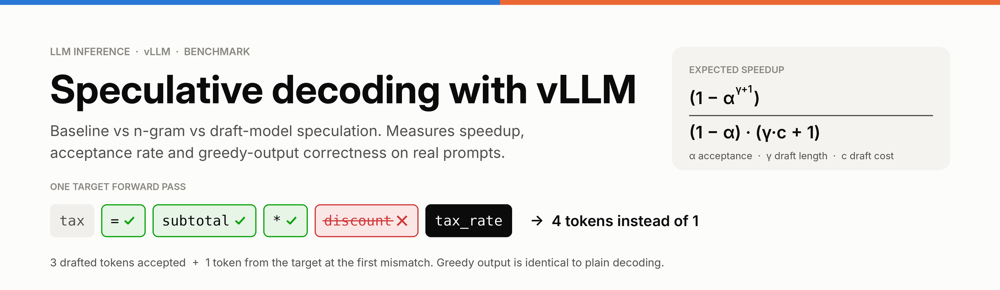
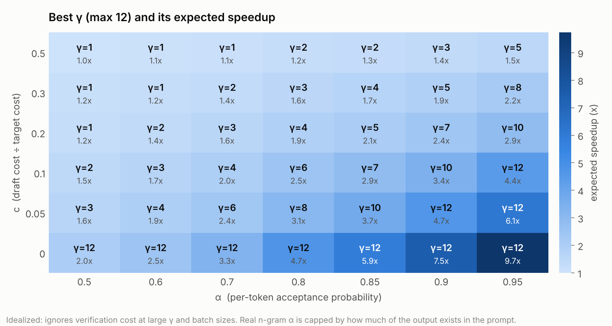
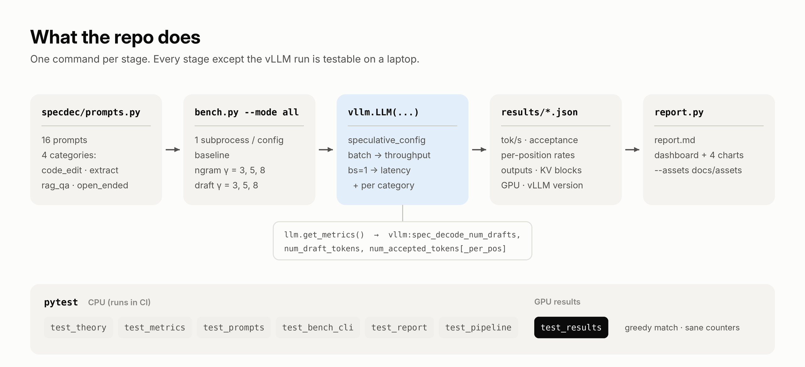

<p align="center">
  
</p>

<p align="center">
  <a href="https://github.com/AhmedMujtaba999/ci.yml"></a>
  
  
  <a href="LICENSE"></a>
  <a href="https://colab.research.google.com/github/AhmedMujtaba999/colab_quickstart.ipynb"></a>
</p>

A reproducible benchmark of **speculative decoding in vLLM**. It runs the same prompts through a
baseline, **n-gram (prompt-lookup)** speculation and **draft-model** speculation, then answers three
questions with numbers:

1. **Is it faster for my workload?** Throughput when batched *and* at batch size 1, per prompt category.
2. **Why?** Acceptance rate, tokens per target pass and per-position acceptance, compared with theory.
3. **Is the output still correct?** Greedy outputs are diffed against the baseline on every run.

## Demo

<p align="center">
  
</p>

<p align="center"><sub>Illustration of the mechanism (not a measurement). Full 52-second walkthrough with the config knobs, a real CPU test run and the theory: <a href="demo.mp4"><b>demo.mp4</b></a></sub></p>

## How it works

<p align="center"></p>

Decode is **memory-bandwidth-bound**: every forward pass streams all model weights from GPU memory,
so scoring 5 tokens costs about the same as scoring 1. Speculative decoding exploits that. A cheap
proposer guesses γ tokens, the target checks all of them in **one** pass, keeps them up to the first
disagreement and always adds one token of its own. With greedy sampling the text is identical to
plain decoding; only the number of expensive target passes changes.

| proposer | how it guesses | cost (c) | shines when |
|---|---|---|---|
| **n-gram** (`method: ngram`) | finds the last few tokens in the prompt and copies what followed | ≈ 0, no extra model | output repeats the input: code edits, extraction, RAG quotes |
| **draft model** (`method: draft_model`) | a small model from the same family (Qwen2.5-0.5B for a 3B target) | ≈ 0.1–0.3 of a target pass, plus VRAM | broadly, if the small model agrees often enough |
| **suffix** (`method: suffix`, optional) | suffix tree over the prompt and earlier outputs | ≈ 0 | repetitive, agent-style traffic |

## Quickstart

**On a laptop (no GPU):** tests, theory and the benchmark plan.

```bash
python -m venv .venv && source .venv/bin/activate
pip install -r requirements-dev.txt
pytest                                           # 54 tests; GPU-result checks skip
python -m specdec.theory --alpha 0.8 --c 0.15    # expected speedup table + best gamma
python bench.py --mode all --dry-run             # the 7 configs that will run
```

**On an NVIDIA GPU:** the real benchmark.

```bash
pip install -r requirements.txt                  # vLLM + the dev tools
python bench.py --mode all                       # 7 configs x 2 workloads -> results/*.json
python report.py results --assets docs/assets    # results/report.md + 5 charts
pytest tests/test_results.py -v                  # correctness and sanity checks on your run
```

No GPU at hand? Open the [Colab notebook](notebooks/colab_quickstart.ipynb) and pick an L4 or A100 runtime.

<details>
<summary>More ways to run it</summary>

```bash
python bench.py --mode draft --gamma 5                     # one config
python bench.py --mode all --methods ngram --gammas 2,4,6  # custom sweep
python bench.py --mode all --workload latency              # batch size 1 only (faster)
python bench.py --mode all --methods ngram,draft,suffix    # needs: pip install arctic-inference

# smaller GPU
python bench.py --model Qwen/Qwen2.5-1.5B-Instruct --draft-model Qwen/Qwen2.5-0.5B-Instruct
# T4 / V100 (no bf16)
python bench.py --dtype half --model Qwen/Qwen2.5-1.5B-Instruct
```
</details>

## What gets swept

| config | `speculative_config` | why it is in the sweep |
|---|---|---|
| baseline | none | reference speed and reference outputs |
| ngram γ = 3, 5, 8 | `{"method": "ngram", "num_speculative_tokens": γ, "prompt_lookup_min": 2, "prompt_lookup_max": 4}` | free proposer, depends on copyable text |
| draft γ = 3, 5, 8 | `{"method": "draft_model", "model": "Qwen/Qwen2.5-0.5B-Instruct", "num_speculative_tokens": γ}` | real proposer, costs compute and KV-cache memory |

Each config runs in its **own subprocess** so GPU memory is fully released between runs, after a
warmup (CUDA graphs, compilation). Sampling is greedy (`temperature=0`) so outputs are comparable.

**Two workloads per config**, because speculative decoding is a latency optimization:

- **batch**: all 16 prompts submitted together, median of 3 repeats. Measures throughput when the GPU is busy.
- **latency (bs=1)**: one prompt at a time. The regime speculative decoding targets; also gives per-category numbers.

**Four prompt categories** (`specdec/prompts.py`), from "output copies the prompt" to "nothing to copy":

| category | example task | what n-gram should do |
|---|---|---|
| `code_edit` | rename a function / add validation, return the full code | big win: output is mostly the input |
| `extract` | turn an email or log into JSON, copying values verbatim | big win |
| `rag_qa` | answer from a given context, quoting it | partial win |
| `open_ended` | short story, brainstorm, persuasive paragraph | about nothing: no source to copy |

## What gets measured

10 metrics: 4 speed, 4 acceptance, 1 correctness, 1 memory.

| # | metric | what it measures | when and why it matters |
|---|---|---|---|
| **Speed (4)** | | | |
| 1 | batch tok/s | output tokens / wall time, all prompts at once | throughput when the server is busy |
| 2 | bs=1 tok/s | same, one request at a time | single-user latency, where speculation pays most |
| 3 | speedup | tok/s ÷ baseline tok/s, per workload and per category | the headline number; can be below 1x |
| 4 | ms per token (bs=1) | wall time per output token, prefill included | what a user of one request feels |
| **Acceptance (4)** | | | |
| 5 | acceptance rate | accepted ÷ drafted tokens (vLLM counters) | how good the proposer is; not the same as α |
| 6 | tokens / step | 1 + accepted ÷ drafts (vLLM "mean acceptance length") | tokens gained per target pass, between 1 and γ + 1 |
| 7 | per-position acceptance | P(draft position i accepted) | should decay with i; tells you where γ stops paying |
| 8 | est. α | per-token acceptance implied by tokens/step | plugs straight into the theory formula |
| **Correctness (1)** | | | |
| 9 | greedy match | % of outputs identical to the baseline | speculative decoding must be lossless |
| **Memory (1)** | | | |
| 10 | KV-cache blocks | cache capacity left after weights load | a draft model's weights and cache eat into it |

Acceptance counters come from `llm.get_metrics()` (`vllm:spec_decode_num_drafts`,
`num_draft_tokens`, `num_accepted_tokens`, `num_accepted_tokens_per_pos`), snapshotted before and
after each workload and diffed, so warmup never leaks into the numbers. `bench.py` sets
`disable_log_stats=False`, which the offline `LLM` needs before it exports these counters.

## Results

Every number comes from **your own GPU run**; nothing in this repo is pre-filled. After
`python report.py results --assets docs/assets`, the charts land in `docs/assets/results_*.png` and
the tables in `results/report.md`. Paste them here:

<!-- Uncomment after your run and paste the summary table from results/report.md:
**Setup:** <GPU>, vLLM <version>, target Qwen2.5-3B-Instruct, draft Qwen2.5-0.5B-Instruct, 16 prompts, max_tokens 256

<p align="center"></p>

| config | batch tok/s | batch speedup | bs=1 tok/s | bs=1 speedup | accept rate | tokens/step | est. α | KV blocks | greedy match |
|---|---:|---:|---:|---:|---:|---:|---:|---:|---:|
-->

The report contains a summary table, per-category speedup and acceptance tables, the best config
overall and per category, failed or unsupported configs, and a 2×2 dashboard: speedup at bs=1 vs
batched, tokens per step vs γ, a category heatmap, and per-position acceptance against theory.

**What to look for**

1. **n-gram** should win clearly on `code_edit` and `extract`, a little on `rag_qa`, and barely at all on `open_ended`.
2. **Draft model** should help more evenly across categories, at the cost of fewer KV-cache blocks.
3. **bs=1 speedup > batched speedup.** As batches grow, decode stops being memory-bound and verifying γ + 1 tokens per request is no longer free; batched speedup can drop below 1x.
4. **Bigger γ is not always better.** Watch tokens/step flatten and per-position acceptance fall.
5. **Greedy match near 100%.** Rare mismatches come from floating-point near-ties (bf16, different batch shapes); a large drop is a bug.

## Theory

With per-token acceptance α, draft length γ and draft cost c (relative to one target pass), the
expected tokens per target pass and speedup are ([Leviathan et al., 2023](https://arxiv.org/abs/2211.17192)):

```
E[tokens per pass] = (1 − α^(γ+1)) / (1 − α)
expected speedup   = E[tokens per pass] / (γ·c + 1)
```

<p align="center"></p>

Two things the curves make obvious:

- **A free proposer never hurts in theory** (n-gram, c ≈ 0); in practice it only helps when the text is copyable.
- **A paid proposer has a break-even point.** At c = 0.25 the draft model is slower than baseline until α reaches about 0.45 (γ = 3) to 0.68 (γ = 8): longer drafts need higher α to pay off.

<p align="center"></p>

**Acceptance rate is not α.** Acceptance stops at the first miss, so later draft positions are
rarely reached. At α = 0.8 and γ = 5 vLLM would report an acceptance rate of about 0.54, not 0.8.
`specdec.theory` converts in both directions, and the report shows the α implied by your run:

```bash
python -m specdec.theory --alpha 0.8 --c 0.15
# best gamma = 5  ->  2.11x expected speedup
```

## Project structure

<p align="center"></p>

```
specdec-vllm/
├── bench.py                  # sweep runner: 1 subprocess per config, batch + bs=1 workloads
├── report.py                 # results/*.json -> report.md + dashboard + 4 single charts
├── specdec/
│   ├── prompts.py            # 16 prompts in 4 categories, round-robin, deterministic
│   ├── theory.py             # closed-form speedup, inverses (α from tokens/step), best γ; CLI
│   ├── metrics.py            # snapshot / diff / summarize vLLM spec-decode counters
│   └── style.py              # one chart style for the report and README images
├── tests/                    # 54 CPU tests + checks on real GPU results
├── notebooks/colab_quickstart.ipynb
├── scripts/                  # regenerate README images and the demo video (no GPU)
├── docs/assets/              # README images, demo.mp4, demo-race.gif
├── .github/workflows/ci.yml  # CPU tests on Python 3.10 and 3.12
└── Makefile                  # make test | plan | bench | report | assets
```

## Tests

| file | runs on | checks |
|---|---|---|
| `test_theory.py` | CPU | known values, bounds (1 to γ+1 tokens), monotonicity, α inverses, best γ |
| `test_metrics.py` | CPU | counter parsing, `_total` suffix, multi-engine sums, diffs, per-position rates |
| `test_prompts.py` | CPU | balanced categories, determinism, copy-heavy prompts have source text |
| `test_bench_cli.py` | CPU | `speculative_config` per mode, sweep plan, dry run, failure files |
| `test_report.py` | CPU | report math and charts on **synthetic** fixtures, schema-1 compatibility |
| `test_pipeline.py` | CPU | `bench.py` → JSON → `report.py` end to end against a **fake** `vllm` module: stats logging on, counters diffed per workload, unsupported methods recorded |
| `test_results.py` | your results | greedy match ≥ 75%, counters within bounds, per-position decay, n-gram hypothesis (xfail if your data disagrees) |

## Compatibility notes

- Built for the vLLM **V1 engine** and `speculative_config={...}` (the old `--speculative-model` flags are deprecated).
- **n-gram** works on vLLM ≥ 0.10. **Draft-model** speculation (`"method": "draft_model"`) was removed when V1 became the only engine and re-added in 2026 ([vllm#24322](https://github.com/vllm-project/vllm/pull/24322)); if your vLLM rejects it, upgrade (`pip install -U vllm`). Either way the sweep keeps going: a config that fails is saved as `status: "failed"` and listed in the report.
- Draft and target must share a tokenizer (same model family) unless you enable vLLM's `use_heterogeneous_vocab`.
- GPUs without bf16 (T4, V100): pass `--dtype half`.

## Regenerating the images and video

```bash
make assets   # python scripts/make_readme_assets.py && python scripts/make_demo_video.py (needs ffmpeg)
```

The demo's terminal scene is captured live from `pytest`, `specdec.theory` and `bench.py --dry-run`
each time the script runs.

## Roadmap

- [ ] EAGLE-3 head for the target model (`"method": "eagle3"`)
- [ ] Online serving benchmark with `vllm bench serve` across request rates (QPS), not just offline batches
- [ ] Sampling with temperature > 0 (probabilistic acceptance)
- [ ] Prometheus + Grafana panels for acceptance rate in a live server

## References

- Leviathan, Kalman, Matias. [Fast Inference from Transformers via Speculative Decoding](https://arxiv.org/abs/2211.17192) (2023)
- Chen et al. [Accelerating Large Language Model Decoding with Speculative Sampling](https://arxiv.org/abs/2302.01318) (2023)
- Saxena. [Prompt Lookup Decoding](https://github.com/apoorvumang/prompt-lookup-decoding) (2023)
- Li et al. [EAGLE: Speculative Sampling Requires Rethinking Feature Uncertainty](https://arxiv.org/abs/2401.15077) (2024)
- vLLM docs: [Speculative Decoding](https://docs.vllm.ai/en/latest/features/speculative_decoding/)

## License

[MIT](LICENSE) © 2026 Ahmed Mujtaba Ali
